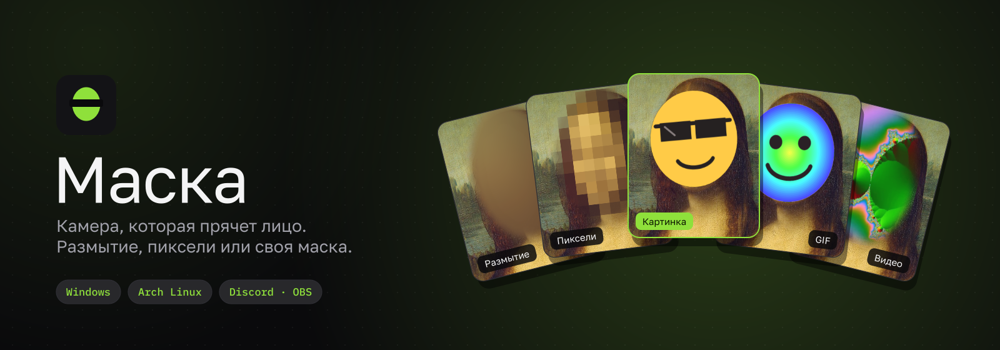
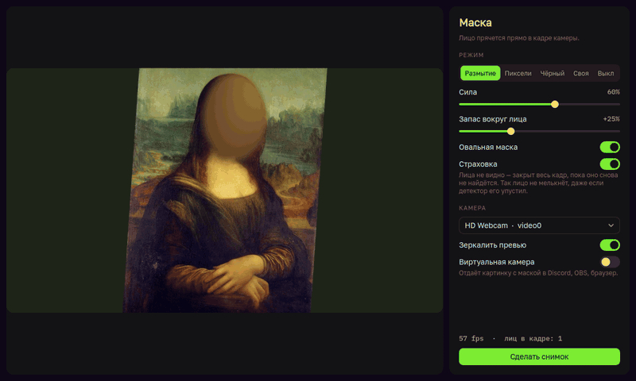
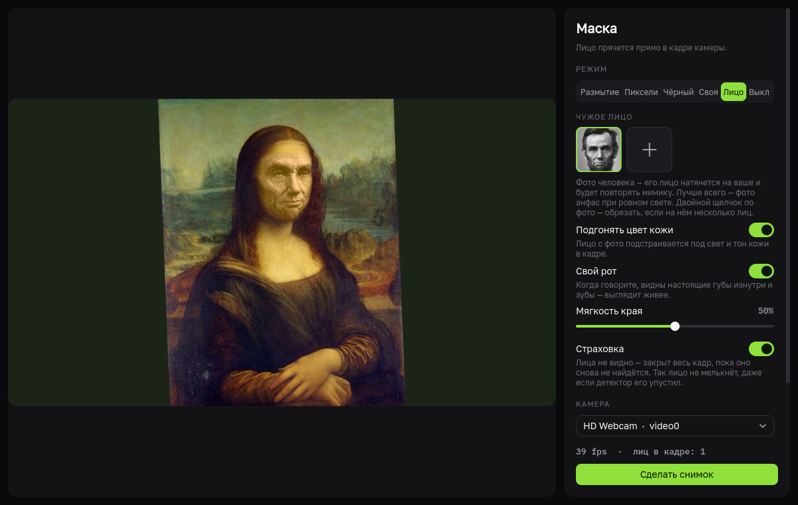
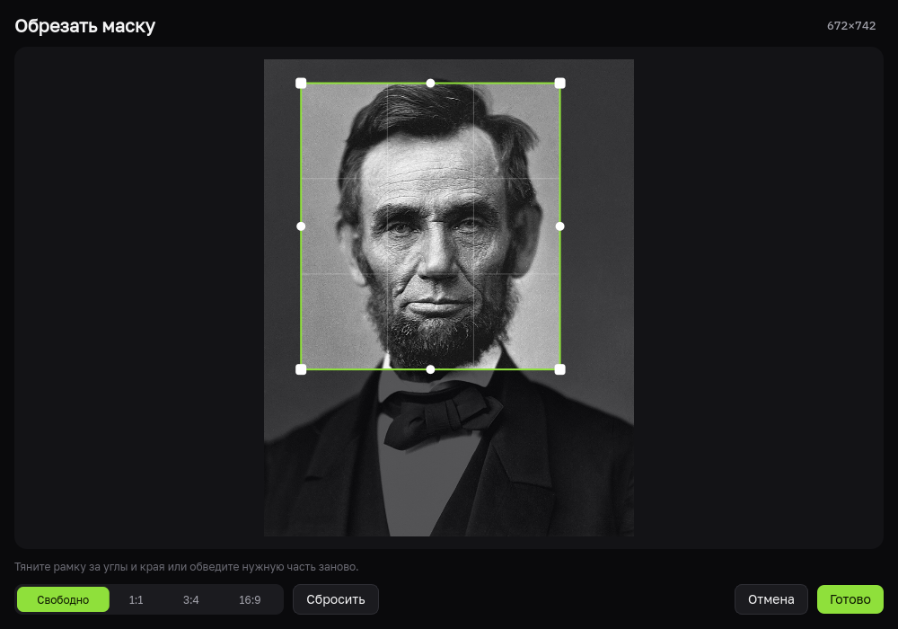
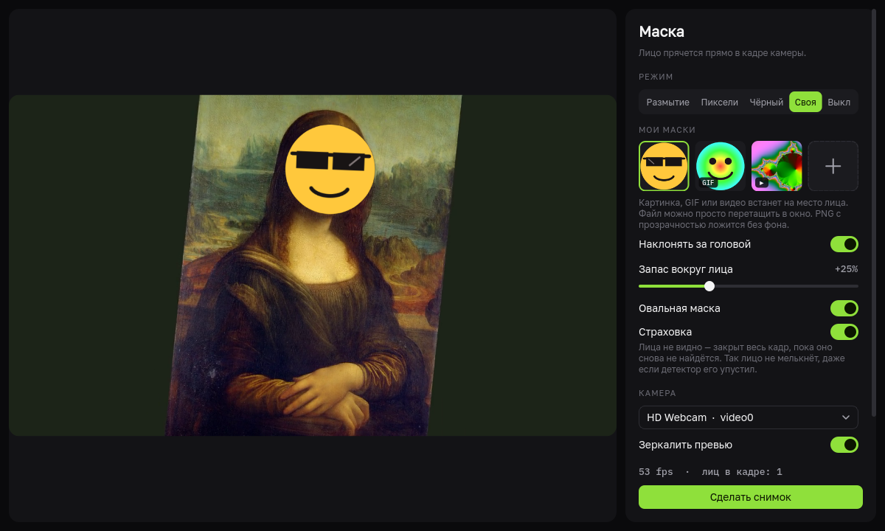

<div align="center">



<br>

[](https://github.com/Flenstick/maska/releases/latest)
[](https://github.com/Flenstick/maska/releases)
[](https://github.com/Flenstick/maska/actions/workflows/release.yml)
[](LICENSE)

**Вебка, которая сама находит лицо и закрывает его размытием, пикселями, вашей маской из картинки, GIF
или видео или чужим лицом с фото, которое повторяет вашу мимику. Картинка с маской уходит в Discord, OBS и браузер.**

[**⬇ Скачать для Windows**](https://github.com/Flenstick/maska/releases/latest) &nbsp;·&nbsp;
[**Установить на Arch Linux**](#arch-linux) &nbsp;·&nbsp;
[Что нового](CHANGELOG.md)

<br>



</div>

<br>

## Что умеет

<table>
<tr>
<td width="50%" valign="top">

### 🎭 Свои маски
Картинка, **GIF** или **видео** встаёт на место лица и ездит вместе с ним.
PNG и GIF с прозрачностью ложатся без фона, видео и анимации крутятся по кругу.
Маска наклоняется вслед за головой.

</td>
<td width="50%" valign="top">

### 🫥 Размытие, пиксели, заливка
Классика для стримов и созвонов: сила размытия, размер пикселей,
запас вокруг лица и мягкий овальный край настраиваются ползунками.

</td>
</tr>
<tr>
<td valign="top">

### 🧑 Чужое лицо
Режим «Лицо»: берёте фото человека, и его лицо натягивается на ваше по 468 точкам.
Оно повторяет мимику и моргает вместе с вами, подстраивается под свет и цвет кожи, а рот остаётся вашим, так что речь выглядит живой.

</td>
<td valign="top">

### ✂️ Обрезка
Двойной щелчок по маске открывает обрезку: рамкой выбираете нужную часть картинки или видео,
белыми ручками на ленте задаёте отрезок видео или GIF. Сам файл не меняется.

</td>
</tr>
<tr>
<td valign="top">

### 🛡 Страховка
Детектор упустил лицо (повернулись, закрылись рукой, темно)? Маска
держится по оптическому потоку, а если лицо совсем пропало, закрывается весь кадр. Лицо не мелькнёт.

</td>
<td valign="top">

### 📡 Виртуальная камера
В Discord, OBS, Zoom или браузере выбираете камеру «Маска» и показываете
уже обработанную картинку. Linux: v4l2loopback, Windows: виртуальная камера OBS.

</td>
</tr>
</table>

<div align="center">

<br><br>

<br><br>

</div>

## Установка

### Windows

1. Скачайте **`Maska-Setup-….exe`** со страницы [последнего релиза](https://github.com/Flenstick/maska/releases/latest) и запустите.
   Права администратора не нужны. Без установки можно взять портативный архив **`Maska-…-Windows-portable.zip`**.
2. Для Discord и других программ нужна виртуальная камера: поставьте
   [OBS Studio](https://obsproject.com) (запускать его не нужно), а в «Маске» включите «Виртуальная камера».
   В Discord выберите камеру **OBS Virtual Camera**.

> Windows SmartScreen может предупредить о неизвестном издателе: «Подробнее» → «Выполнить в любом случае».

### Arch Linux

Одна команда ставит и потом обновляет «Маску» через pacman:

```sh
curl -fsSL https://raw.githubusercontent.com/Flenstick/maska/main/packaging/arch/install.sh | sh
```

Работает на Arch и производных (CachyOS, EndeavourOS, Manjaro). Пакет `.pkg.tar.zst` лежит и в
[релизах](https://github.com/Flenstick/maska/releases/latest): его можно поставить вручную, `sudo pacman -U maska-*.pkg.tar.zst`.

**Виртуальная камера для Discord и OBS** включается один раз:

```sh
maska-setup-vcam
```

Команда грузит модуль `v4l2loopback` и прописывает его автозагрузку. В CachyOS модуль уже есть в ядре,
на обычном Arch сначала поставьте `sudo pacman -S v4l2loopback-dkms linux-headers`.
После этого «Маска» сама отдаёт картинку в камеру с тем же названием, пока её окно открыто.

## Как пользоваться

1. Выберите режим **«Своя»** и нажмите **＋** в «Мои маски» или просто перетащите файл в окно.
   Подходят PNG, JPG, WebP, GIF, MP4, WebM, MOV и другие. После добавления сразу откроется обрезка,
   позже её можно вызвать двойным щелчком или правой кнопкой → «Обрезать…».
2. Режим **«Лицо»**: добавьте фото человека. Лучше всего подходит фото анфас при ровном свете.
   Если на фото несколько людей, обрежьте его вокруг нужного лица. Когда сетка лица не ложится
   (резкий поворот, рука у лица), лицо на этот момент просто размывается.
3. Ползунок **«Запас вокруг лица»** задаёт размер маски, **«Овальная маска»** даёт мягкий край
   (для картинок с прозрачностью край не нужен, у них он свой).
4. Удалить маску можно правой кнопкой по плитке. Маски хранятся в папке программы:
   `%APPDATA%\Maska\masks` на Windows и `~/.local/share/maska/masks` на Linux.
5. Снимки по кнопке «Сделать снимок» сохраняются в «Изображения/Маска».

## Запуск из исходников

```sh
git clone https://github.com/Flenstick/maska && cd maska
python -m venv .venv && .venv/bin/pip install -r requirements.txt
.venv/bin/python maska.py
```

На Windows: `.venv\Scripts\pip install -r requirements.txt`, потом `.venv\Scripts\python maska.py`.

## Выпуск новой версии

Одна команда собирает всё сразу:

```sh
./release.sh 1.1.0
```

Скрипт поднимает версию, коммитит, ставит тег и пушит. Дальше [GitHub Actions](.github/workflows/release.yml)
собирает установщик и портативный zip для Windows, пакет для Arch, проверяет, что оба запускаются,
и выкладывает релиз. Описание релиза берётся из раздела `## 1.1.0` в [CHANGELOG.md](CHANGELOG.md),
а если такого раздела нет, из списка коммитов.

## Под капотом

Python + PyQt6. Новые версии программа находит сама: на Windows и в пакете для Arch их ставит кнопка «Обновить». Лица ищет [YuNet](https://github.com/opencv/opencv_zoo/tree/main/models/face_detection_yunet) из OpenCV,
между кадрами их ведёт оптический поток Лукаса — Канаде. Наклон головы считается по линии глаз.
Для замены лица 468 точек ищет сетка лица MediaPipe прямо через OpenCV DNN, лицо деформируется по треугольникам
одним `remap` (около 10 мс на кадр), цвет подгоняется в LAB.
Виртуальная камера на Linux пишет кадры прямо в `v4l2loopback` (I420), на Windows работает через
[pyvirtualcam](https://github.com/letmaik/pyvirtualcam) и камеру OBS.

<div align="center">
<sub>MIT © MrFlen · Мона Лиза на картинках — общественное достояние · YuNet — MIT · MediaPipe Face Mesh — Apache 2.0 · шрифты Golos Text и IBM Plex Mono — OFL</sub>
</div>
